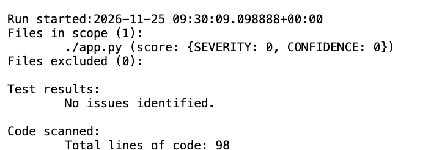
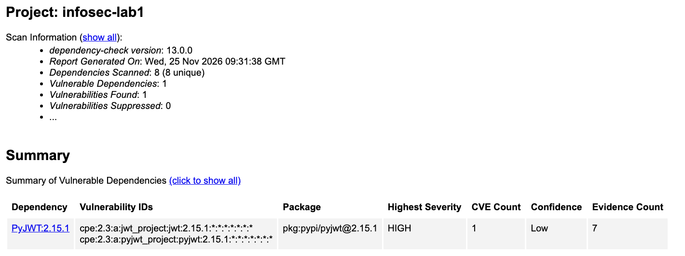

# API личных заметок

ЛР1 по информационной безопасности. Flask и SQLite.

Установим зависимости, создадим пользователя `student` и запустим сервер.

```sh
python3 -m venv .venv && . .venv/bin/activate
pip install -r requirements.txt
export JWT_SECRET="$(python -c 'import secrets; print(secrets.token_hex(32))')"
flask --app app create-user student
flask --app app run
```

В другом терминале подставим свой пароль вместо `ПАРОЛЬ`. Получим токен через `jq`, добавим заметку и прочитаем её.

```sh
url=http://127.0.0.1:5000
token=$(curl -s "$url/auth/login" --json '{"login":"student","password":"ПАРОЛЬ"}' | jq -r .token)
curl "$url/api/data" -H "Authorization: Bearer $token" --json '{"text":"Сдать <ИБ> & ОПД"}'
curl "$url/api/data" -H "Authorization: Bearer $token"
```

`POST /auth/login` выдаёт JWT на 30 минут. Для `POST /api/data` (добавить заметку) и `GET /api/data` (свои заметки) сервер проверяет подпись HS256 и срок токена. В SQLite хранится scrypt-хэш пароля с солью. Запросы передают значения через `?`, а перед выдачей текста `html.escape` экранирует HTML-символы.

[Отчёт в PDF](report1.pdf) · [Проверки в GitHub Actions](https://github.com/Vaneshik/infosec-lab1/actions/workflows/ci.yml?query=status%3Asuccess)

[](https://github.com/Vaneshik/infosec-lab1/actions/runs/45585964740/job/139107535760)

[](https://github.com/Vaneshik/infosec-lab1/actions/runs/45585964740/job/139107535219)
